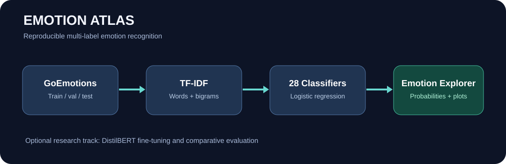

# 🎭 Emotion Atlas — GoEmotions Analysis

**Multi-label emotion recognition with a reproducible machine-learning pipeline, beautiful data visualizations, and an interactive Streamlit explorer.**

> **Project status:** Source code and tests are provided. Training is not run automatically on GitHub; download the dataset and train locally to produce the model, metrics and plots. No benchmark results are claimed without a recorded run.

## The question

Can one short message express multiple emotions at once? GoEmotions provides Reddit comments annotated with **27 emotions plus neutral**. This project treats emotion recognition as a **multi-label** classification task rather than reducing text to positive/negative sentiment.

## Features

- 🔎 **Data exploration:** label frequencies and normalized emotion co-occurrence.
- 🧠 **Interpretable baseline:** TF-IDF (unigrams/bigrams) + one-vs-rest logistic regression.
- ⚖️ **Threshold tuning:** choose a threshold on validation micro-F1, without using test examples to tune it.
- 📈 **Honest evaluation:** micro/macro/sample F1, precision, recall, exact match, Hamming loss and micro average precision.
- 🎨 **Visual analysis:** test F1 by emotion plus validation threshold curve.
- 🚀 **Interactive app:** type text, adjust threshold, inspect per-label probabilities and explore the generated charts.
- 🔬 **Optional transformer:** fine-tune DistilBERT as an independent benchmark.
- ✅ **CI tests:** automated synthetic-data checks without downloading the dataset.

## Quick start

Requires **Python 3.10+**. From the repository root:

~~~bash
git clone https://github.com/vikas56655/goemotions-analysis.git
cd goemotions-analysis
python -m venv .venv
source .venv/bin/activate  # Windows: .venv\Scripts\activate
python -m pip install -r requirements.txt
python -m src.train
streamlit run app.py
~~~

On first training run, Hugging Face downloads the GoEmotions dataset (internet required). The baseline defaults to reproducible random subsets of **12,000 train / 2,000 validation / 2,000 test** examples, making the demo easier to run on a laptop. Reported metrics describe those sampled splits, not the entire benchmark.

For **full splits**:

~~~bash
python -m src.train --max-train 0 --max-val 0 --max-test 0
~~~

For unit tests:

~~~bash
python -m pip install pytest
pytest -q
~~~

## Visual gallery

Plots are **generated from the actual training and evaluation arrays**. Run training first to create these files:

| Figure | Question answered |
| --- | --- |
| reports/label_frequency.png | Which emotions are common or rare? |
| reports/cooccurrence.png | Which emotion labels tend to appear together? |
| reports/per_label_f1.png | Which emotions does the baseline identify best? |
| reports/threshold_curve.png | How does validation F1 vary with the decision threshold? |

The Streamlit app displays the figures automatically when they exist. We do not include fabricated benchmark screenshots.

## Optional transformer experiment

For a separate DistilBERT fine-tuning experiment:

~~~bash
pip install -r requirements-transformer.txt
python -m src.train_transformer --max-train 4000 --max-val 800 --max-test 800
~~~

This path downloads pretrained weights and can be expensive on CPU; GPU recommended. Transformer artifacts and metrics appear under `models/transformer/`. **Do not compare default baseline and transformer scores as a controlled head-to-head benchmark** because their default sample sizes differ. Re-run both with equal sample sizes, split seeds, and a documented hardware/setup budget for a fair comparison.

## Project layout

~~~text
.
├── app.py                       # interactive Streamlit explorer
├── assets/architecture.svg      # visual architecture
├── src/
│   ├── data.py                  # dataset loader and label encoding
│   ├── metrics.py               # multi-label metrics and threshold selection
│   ├── visualize.py             # data-derived publication figures
│   ├── train.py                 # TF-IDF + logistic regression baseline
│   └── train_transformer.py     # optional DistilBERT fine-tuning
├── tests/                       # fast offline unit tests
├── .github/workflows/ci.yml     # GitHub Actions
├── requirements.txt
└── requirements-transformer.txt
~~~

Training generates `models/baseline.joblib`, `models/metadata.json`, and `reports/*.png` / `reports/metrics.json`. These are ignored by Git to avoid checking in large generated artifacts or unverified evaluation scores.

## Experimental design

1. Use the dataset's official **simplified** train, validation and test splits.
2. Fit TF-IDF and logistic regression **only on training text**.
3. Optimize one shared decision threshold using **validation micro-F1**.
4. Evaluate the final tuned predictor **once on test**.
5. Report per-label F1 to reveal minority-class limitations and plot observed label frequencies.
6. Treat predictions as *text-label estimates*, not assessments of a person's mental health.

**Limitations:** Emotion annotations are subjective; some labels are highly imbalanced. Reddit language differs from other domains, and labels may have systematic cultural or demographic biases. Probability calibration has not been independently validated.

## Dataset and attribution

Demszky et al. (2020), *GoEmotions: A Dataset of Fine-Grained Emotions*, ACL. [Official research repository](https://github.com/google-research/google-research/tree/master/goemotions) · [Hugging Face dataset](https://huggingface.co/datasets/google-research-datasets/go_emotions).

Dataset and model weights retain their respective upstream licenses. No Reddit examples or downloaded weights are committed here.

## Reproducibility

Python dependencies are bounded but not lockfile-pinned, so package upgrades may change results. Save your exact environment, dataset revision, GPU/CPU details and emitted `metrics.json` for a publication-grade comparison. Never load an untrusted joblib model file.

## Author

[Vikas Singh](https://github.com/vikas56655) · [Portfolio](https://vikas56655.github.io)
